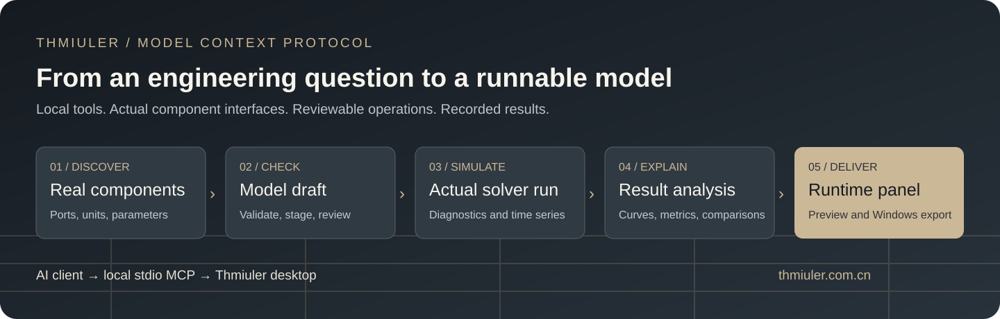

# Thmiuler MCP and Windows downloads

**Connect an MCP AI client to a real engineering model.** Thmiuler is a desktop simulation application with a local Model Context Protocol server. An AI client can discover installed components, inspect their actual ports, prepare a checked model draft, run a simulation, and read the resulting curves and statistics.

[Download the Windows installer](https://github.com/Redlargeforest/Thmiuler-Releases/releases/latest) · [MCP quick start](docs/MCP_QUICKSTART.md) · [Official website](https://thmiuler.com.cn/)



## What the MCP connection lets you do

| Engineering task | Thmiuler capability |
| --- | --- |
| Find the right building blocks | Search the installed component catalog and inspect exact ports, parameters, units, and component identities. |
| Build a model you can review | Validate a candidate graph, check physical and signal connections, then stage a reversible draft on the canvas. |
| Check a design with actual results | Run the model, inspect diagnostics, read recorded time series, analyze retained samples, and request native curve images. |
| Create an interactive simulation panel | Bind inputs, indicators, and plots to real model variables; inspect the running preview and compare supported optimization candidates. |
| Deliver a runtime panel | Export a supported model and panel as a Windows EXE, then validate the exported artifact on the intended target computer. |
| Extend the component library | With explicit approval, generate a structured component definition, compile it, and check runtime loading before adding it to the AI component library. |

The MCP server uses the application's modeling and simulation checks. Connection validation checks interfaces and model structure; it does not establish that a model is physically correct for every operating condition. Engineering assumptions, parameter evidence, solver choices, and result acceptance remain part of the workflow.

## Connect your AI client

Install the complete Windows package. In a client that supports local MCP servers over **stdio**, add this server configuration, adjusting the installation path if necessary:

```json
{
  "mcpServers": {
    "thmiuler": {
      "command": "C:\\Thmiuler\\THMIULER-MCP.exe"
    }
  }
}
```

Client configuration screens and supported settings differ. Keep the complete application folder together, including `bin`, `runtime`, and `resources`; moving the MCP executable alone is insufficient. The current desktop interface and much of the bundled help are in Chinese. An English-speaking client can use the structured MCP tools and explain the returned model information in English.

Try this first:

> Read Thmiuler's status and list the available component libraries. Do not change my project. Inspect the actual interfaces before suggesting a model.

For a modeling task:

> Help me model a hydraulic lift. First define the load, target motion, operating conditions, and assumptions. Find the installed components and inspect their ports. Explain the governing relationships and predict the result. Validate and stage a draft for review. Ask before applying or saving it. Use actual simulation data to compare the baseline with one meaningful alternative.

[Read the full connection and modeling guide](docs/MCP_QUICKSTART.md).

## Download and install

Open [Releases](https://github.com/Redlargeforest/Thmiuler-Releases/releases/latest) and download **all four binary assets**, plus `JoinInstaller.ps1` and `SHA256SUMS.txt`:

```text
Thmiuler.exe
Thmiuler-1.bin.part01
Thmiuler-1.bin.part02
Thmiuler-2.bin
JoinInstaller.ps1
SHA256SUMS.txt
```

Keep them in one folder. Run the supplied helper to verify every binary download and reconstruct `Thmiuler-1.bin`, then launch `Thmiuler.exe`. The large BIN is split only to fit GitHub's per-asset limit; reassembly restores the original bytes.

See [installation, checksums, and the manual reassembly alternative](docs/INSTALLATION.md). This release is the Windows x64 installer snapshot dated **27 October 2026**; it is not a separate Windows 7 package.

## See an engineering example

[Watch the English tank-preheating case](https://www.youtube.com/watch?v=FJU3iYMHneo): an engineering question, a governing principle, a model, and a comparison of simulated operating conditions.

## About this repository

This is the official **binary distribution and documentation repository**. The proprietary main application source is not published here. Installers retain their bundled component-library code, teaching examples, and third-party notices. Downloading the software does not make it open source; applicable product terms and third-party licenses continue to apply. See [NOTICE](NOTICE.md).

GitHub's automatically generated **Source code** archives contain this repository's documentation and small setup helpers, not the application installer or its proprietary source. Use the named release assets above to install the product.

For product information and support, visit **[thmiuler.com.cn](https://thmiuler.com.cn/)**. When reporting a problem, include the release date, Windows version, MCP client, reproduction steps, and a sanitized error message. Do not post private projects, credentials, or account data in public issues.
